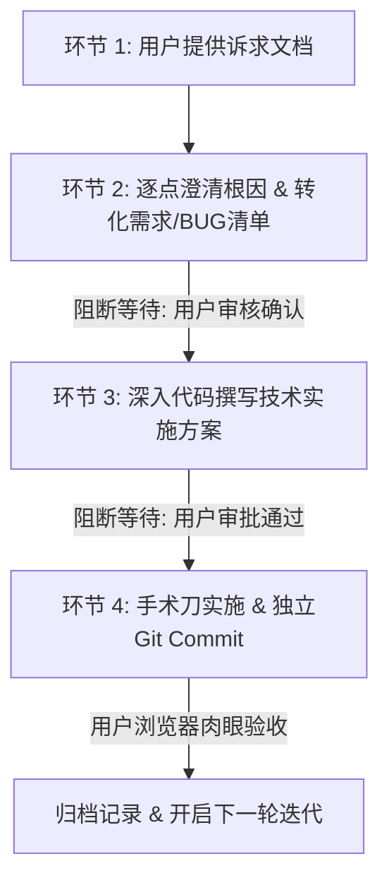

# 🤖 AGENTS.md · Google Antigravity 个人站项目协作准则

本项目为 **Felix Huang** 的个人展示主页（AI Native Product Builder · 以第一性原理打造确定性交付的 AI 产品），基于 Google Antigravity 官方展示页源码深度手术刀式改造。

---

## 🎯 核心原则与第一性原理 (Core Principles)

1. **动效守恒原则 (Animation Preservation)**：
   - 必须 100% 继承并尊重原版 Antigravity 的原生设计资产：包括 GSAP ScrollTrigger 滚动视差、SplitText 字符流光点亮、官方药丸 CTA 按钮规范、宏观 36px 圆角与 3D 粒子系统；
   - 严禁随意重写覆盖原站已验证的动效脚本，改动必须基于原生 DOM 骨架进行手术刀级替换。
2. **轻量与响应敏捷度 (Lightweight Interaction)**：
   - **严禁启动沉重的 Browser Subagent 录屏或截屏**，改由用户在本地 `http://localhost:3000/` 肉眼即时验收，保持 Agent 思考与响应速度在秒级完成。
3. **中文思考与事实量化文风 (Tone & Humanizer)**：
   - 内部推理与思考过程**必须完全使用简体中文**；
   - 文风遵循 `humanizer-zh`，事实量化驱动，严禁浮夸宣传语或 AI 腔调。
4. **终端环境与 Git 规范**：
   - PowerShell 5.1 环境连接命令必须使用 `;`，包含中文必须预先设置 `chcp 65001`；
   - 每次有实质性功能、修复或结构推进，均必须执行规范、可溯源的 Git Commit。

---

## 🛡️ 严格四环节迭代开发 SOP (Iteration Workflow)

后续所有 BUG 修复、视觉微调、交互重构，必须严格按照以下四环节执行。**每一步均设置阻断审批点，未获批准绝不盲目跳步修改代码**：



### 环节 1：用户输入诉求 (User Input)
- 用户提供一批问题反馈、体验不顺畅点或 BUG 观察。

### 环节 2：逐点澄清与清单转化 (Clarification & Triage)
- Agent 必须深入代码层，对每个反馈点：
  1. **定位根因**：分析底层 DOM、CSS 样式或 JS 逻辑；
  2. **说明原因**：讲清楚当前为何呈现此现象；
  3. **定性归类**：区分 `[BUG 修复]`、`[动效/交互调优]`、`[需求/视觉重构]`；
  4. **明确预期**：定义客观交付与验收标准；
- 沉淀至 `iterations/vX.X/02-requirements-and-bugs.md`；
- **【阻断】停下来等待用户审核确认**。

### 环节 3：制定技术实施方案 (Technical Proposal)
- 经审核通过后，输出代码级的《技术实施方案》：
  - 明确修改的文件路径、精确定位行数、选择器；
  - 核心逻辑变更方案（评估对 GSAP/SplitText 动效的影响）；
  - 备选方案对比与决策理由（正答为什么选择该路径）；
- 沉淀至 `iterations/vX.X/03-tech-proposal.md`；
- **【阻断】停下来等待用户审批通过**。

### 环节 4：代码执行与用户验收 (Execution & Sign-off)
- 仅在方案获批后，才开始调用代码编辑工具；
- 实施后执行规范的 Git Commit；
- 提示用户在浏览器 `http://localhost:3000/` 肉眼验收。

---

## 📂 迭代目录规范 (Iterations Structure)

目录遵循**按迭代版本自包含闭环**管理：

```text
iterations/
├── README.md                          # 迭代索引与流程说明
└── v1.0/                              # 当前进行中的第一轮综合体验精修
    ├── 01-user-request.md             # 原始诉求备份
    ├── 02-requirements-and-bugs.md    # 澄清原因与待审需求/BUG清单
    ├── 03-tech-proposal.md            # 代码级技术实施方案 (待审)
    └── 04-change-log.md               # 验收通过后的变更日志
```
