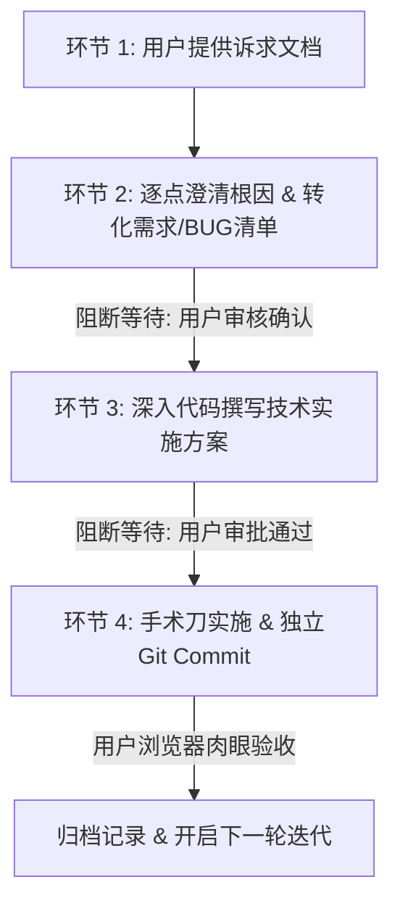

# 🤖 AGENTS.md · Google Antigravity 个人站项目协作准则

本项目为 **Felix Huang** 的个人展示主页（AI Native Product Builder · 以第一性原理打造确定性交付的 AI 产品），基于 Google Antigravity 官方展示页源码深度手术刀式改造。

---

## 🎯 核心原则与第一性原理 (Core Principles)

### 1. 动效守恒与最小侵入原则 (Animation Preservation & Minimal Invasion)
- **只改内容，不破骨架**：尽可能 100% 继承并尊重原版 Antigravity 的原生设计资产。改动只聚焦在上层展示文案与业务资产的替换，**严禁随意大改、破坏或推倒重写底层组件本身，除非业务强诉求所必须**；
- **原生动效钩子完整性**：必须严格保留原版 GSAP ScrollTrigger 滚动视差、SplitText 字符流光逐字点亮（如 `data-feature-title`、`data-feature-desc`）、打字机引擎（`data-typed-header`）、3D 跟随光标（`data-custom-cursor-wrapper`）、3D 粒子流光系统与官方药丸 CTA 按钮规范（36px 宏观圆角与 hover 缓动）；
- **重写的动效一致性底线**：若因业务形态差异确实需要重写某个组件（例如全屏深度演示弹窗），**必须以“动效一致性”为铁律**，必须完整复刻 Google / Apple 级的高级缓动曲线（如 `cubic-bezier(0.16, 1, 0.3, 1)` 弹簧入场、毛玻璃渐现、平滑翻页微位移），绝不允许牺牲质感降级为生硬简陋的 MVP 切换。

### 2. 交互敏捷度与肉眼验收 (No Browser Subagent)
- **严禁启动沉重的 Browser Subagent 进行录屏或截屏**，避免无谓等待与上下文消耗；
- 改由用户在本地 `http://localhost:3000/` 肉眼即时验收，保持 Agent 思考、代码定位与响应速度在秒级完成。

### 3. 强制 Git 原子化提交 (Mandatory Git Commit on Every Change)
- **每次修改皆有提交**：任何实质性功能推进、BUG 修复、视觉样式微调或文档沉淀，在执行后**必须立即执行规范的独立 Git Commit**；
- **提交规范**：遵循语义化提交（如 `feat(...)`、`fix(...)`、`style(...)`、`refactor(...)`、`chore(...)`），保持版本历史清晰、可追溯且随时可安全回滚。

### 4. 中文思考与事实量化文风 (Tone & Humanizer)
- 内部推理与思考过程**必须完全使用简体中文**（严格规定）；
- 个人经历与文案遵循 `humanizer-zh`，事实量化驱动，严禁浮夸宣传语或 AI 腔调。

### 5. 终端环境与文件规范
- PowerShell 5.1 环境命令连接必须使用 `;`，包含中文必须预先设置 `chcp 65001`；
- **Markdown 软路由规范**：迭代文档中的图片统一存储在同级 `assets/` 文件夹下，Markdown 引用使用相对路径（如 ``），严禁内联冗长的 Base64 编码。

---

## 🛡️ 严格四环节迭代开发 SOP (Iteration Workflow)

后续所有 BUG 修复、视觉微调、交互重构，必须严格按照以下四环节执行。**每一步均设置阻断审批点，未获批准绝不盲目跳步修改代码**：



### 环节 1：用户输入诉求 (User Input)
- 用户提供一批问题反馈、体验不顺畅点或 BUG 观察；
- 原始诉求归档至 `iterations/vX.X/01-user-request.md`。

### 环节 2：逐点澄清与清单转化 (Clarification & Triage)
- Agent 深入代码层，对每个反馈点：
  1. **定位根因**：分析底层 DOM、CSS 样式或 JS 逻辑；
  2. **说明原因**：讲清楚当前为何呈现此现象；
  3. **定性归类**：区分 `[BUG 修复]`、`[动效/交互调优]`、`[需求/视觉重构]`；
  4. **明确预期**：定义客观交付与验收标准；
- 沉淀至 `iterations/vX.X/02-requirements-and-bugs.md`；
- **【阻断】停下来等待用户审核确认**。

### 环节 3：制定技术实施方案 (Technical Proposal)
- 经清单审核通过后，输出代码级的《技术实施方案》：
  - 明确修改的文件路径、精确定位行数、选择器；
  - 核心逻辑变更方案（评估对 GSAP/SplitText 动效的影响，坚持最小侵入）；
  - 备选方案对比与决策理由（正答为什么选择该路径）；
- 沉淀至 `iterations/vX.X/03-tech-proposal.md`；
- **【阻断】停下来等待用户审批通过**。

### 环节 4：代码执行与用户验收 (Execution & Sign-off)
- 仅在方案获批后，才开始调用代码编辑工具；
- 实施后**立即执行规范的独立 Git Commit**；
- 提示用户在浏览器 `http://localhost:3000/` 肉眼验收；
- 验收通过后在 `iterations/vX.X/04-change-log.md` 记录归档。

---

## 📂 迭代目录规范 (Iterations Structure)

目录遵循**按迭代版本自包含闭环**管理：

```text
iterations/
├── README.md                          # 迭代索引与流程说明
└── v1.0/                              # 当前进行中的第一轮综合体验精修
    ├── assets/                        # 诉求相关的截图实体文件
    ├── 01-user-request.md             # 环节 1: 原始诉求备份
    ├── 02-requirements-and-bugs.md    # 环节 2: 澄清原因与待审需求/BUG清单
    ├── 03-tech-proposal.md            # 环节 3: 代码级技术实施方案 (待审)
    └── 04-change-log.md               # 环节 4: 验收通过后的变更日志
```
