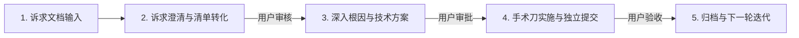

# 🚀 Iteration Engineering & Review System (迭代工程与评审体系)

本项目遵循严格的四步迭代闭环交付流程：

---

## 📋 迭代流程与交付规范

### 环节 1：诉求文档输入 (Input)
- 用户提出一组功能调整、视觉偏差、交互手感或 BUG 观察。

### 环节 2：诉求澄清与需求/BUG 清单转化 (Triage & Clarification)
- 对每个反馈点：
  1. **定位根因**：分析当前代码实现与逻辑；
  2. **说明原因**：讲清楚当前为何呈现此现象；
  3. **定性归类**：区分是 `[BUG 修复]`、`[动效/交互调优]` 还是 `[需求变更]`；
  4. **明确预期**：定义完成后的客观验收标准；
- **阻塞等待**：形成《需求/BUG清单》，提交用户审核确认。

### 环节 3：技术实施方案制定 (Technical Proposal)
- 经审核通过后，输出包含代码级细节的《技术实施方案》：
  - 涉及的具体文件、行数与选择器；
  - 核心 CSS/JS 修改逻辑（确保不破坏原版 GSAP/ScrollTrigger 动效）；
  - 方案设计取舍（为什么方案 A 优于方案 B）；
- **阻塞等待**：提交用户审批。

### 环节 4：代码执行与用户验收 (Execution & Sign-off)
- 用户审批后执行代码修改；
- 执行规范的 Git Commit（如 `fix(...)`、`refactor(...)`）；
- 提交用户在本地浏览器 (`http://localhost:3000/`) 肉眼验收。

---

## 📂 迭代版本归档记录
- `v1.0-refinement/`：第一轮全站体验与动效细节深度精修（进行中）
